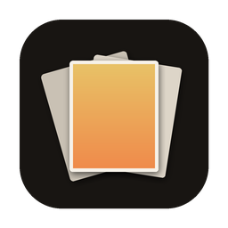
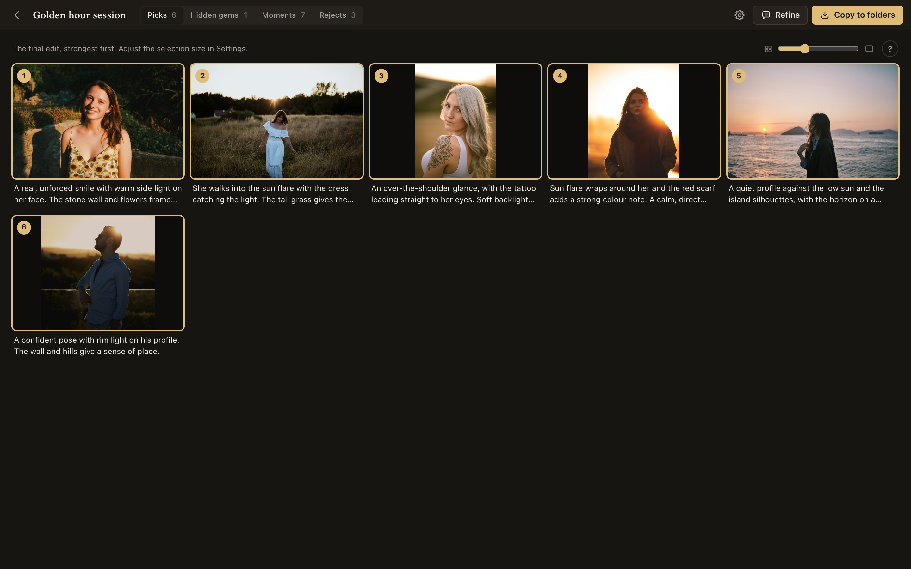
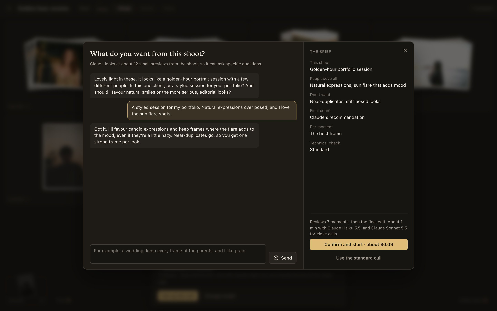
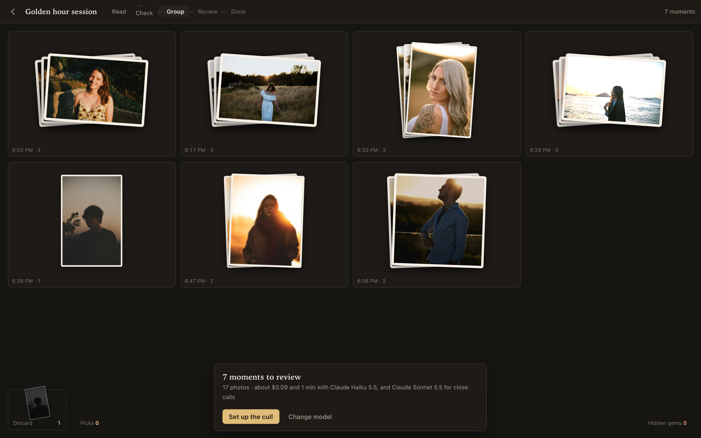
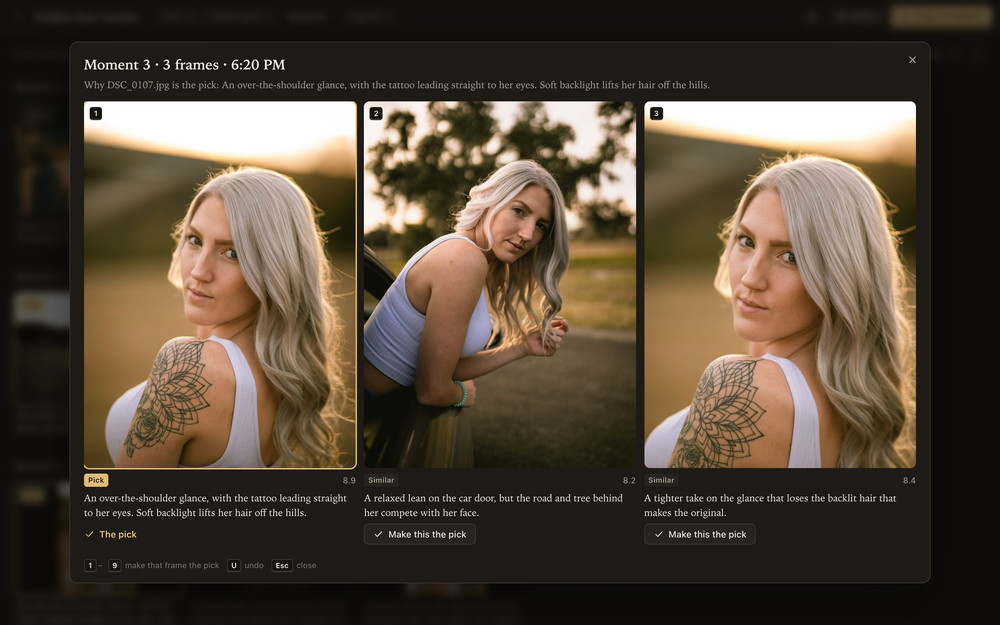
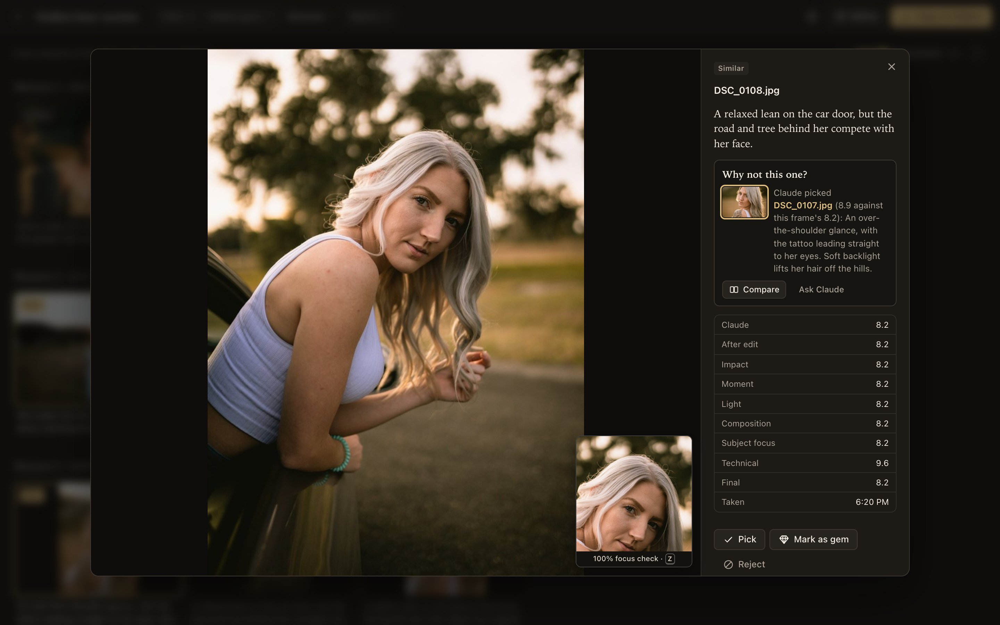
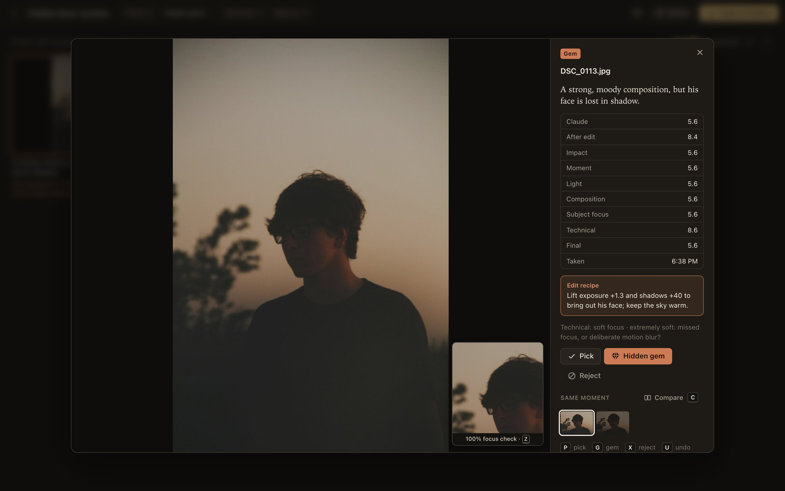
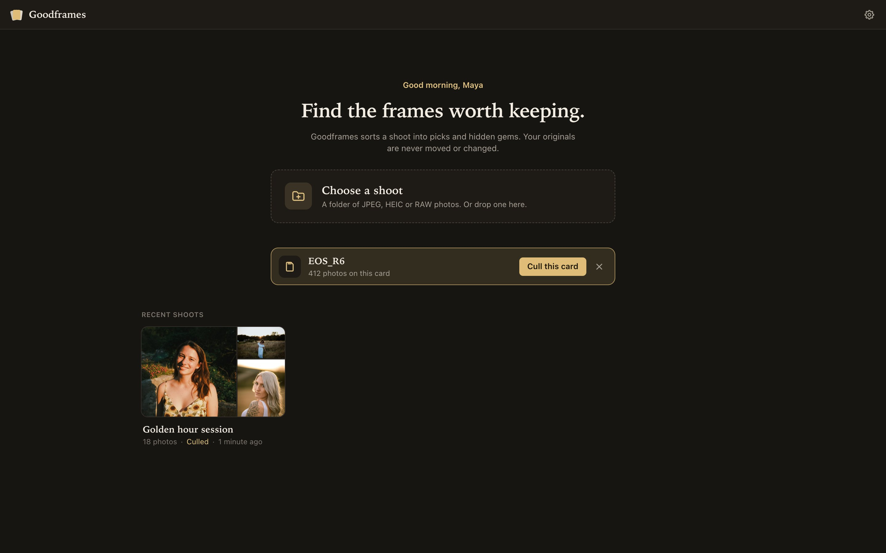
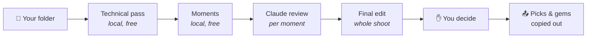

<div align="center">



# Goodframes

**Find the frames worth keeping.**

A Mac app that culls a photo shoot the way a photo editor would. It throws out the blurry,
shaken and blinking frames, keeps the best shot of every moment, and tells you *why* it chose it.


**[Download the beta for Mac](https://github.com/anavekaraditya/goodframes/releases/latest)**

[Features](#features) · [Download](#download) · [Run from source](#run-from-source) · [How it works](#how-it-works) ·
[Keyboard](#keyboard-shortcuts) · [Privacy and cost](#privacy-and-cost) · [FAQ](#faq) ·
[Development](#development)

<br>

<picture>
  <source media="(prefers-color-scheme: light)" srcset="docs/screenshots/results-light.jpg">
  
</picture>

</div>

## Why Goodframes

You come home with 800 frames and want the 40 worth editing. Most culling tools score
sharpness and blinks, then hand you a list of numbers. Goodframes does that step for free on
your Mac, then has Claude look at what's left the way an editor would: the moment, the
expression, the light and the composition. Every pick comes with a reason you can read, check
and overrule.

- 🎯 **It knows what the shoot is for.** Tell it "a styled portfolio session, natural
  expressions, I love sun flare" and the cull follows that brief.
- 💬 **It explains every decision.** "A real, unforced smile with warm side light on her face."
  No black-box scores.
- 💎 **It rescues frames.** *Hidden gems* are strong photos with a fixable flaw, and each one
  comes with an edit recipe.
- 🔒 **Your originals never change.** Nothing is moved, renamed or deleted. Picks are copied
  out next to them.

## Features

### Tell it what the shoot is for

Before anything is sent for review, you chat with Claude about the shoot: who matters, what to
keep, the look you like. It writes a short brief and shows the cost, and the cull starts only
when you confirm. Prefer to skip the chat? **Use the standard cull** is one click.

Need a set number of photos, like 40 for a client gallery? Type it into **Photos you need**. The
cull keeps your best 40. If the shoot has fewer moments than that, the strongest extra frames fill
the set, and if there aren't 40 frames worth keeping, it tells you instead of padding with weak ones.
Changing the number after a cull is free unless new frames need ranking.

Have photos you can't come home without? Add them to the **Shot list**: "Cake cutting", "Whole
family together", "The rings". Claude marks the frames that show each one, and the cull keeps the
best frame of every shot, even when it's weaker than the frames around it. The results show which
shots are covered and which have no frame at all. Adding a shot after a cull reviews the shoot
again (the cost is shown first); removing one is free.

After the cull, a **People** strip shows a face for everyone who appears in three or more photos,
with the number of picks they're in. Anyone in none of your picks is marked. Click a face, or
open the **People** tab, to see everyone in the shoot and each person's photos, split into picks,
other frames and rejects, so you can pick one of theirs right there. You can give people names,
merge two groups that are really one person, take out a photo that isn't them, and hide anyone
who isn't part of the shoot. Each fix can be undone, and it's kept with the shoot. Clicking a
face in a photo's detail view opens that person. Goodframes only groups similar faces within one
shoot. Names are yours to add, and they stay on your Mac like the grouping does.



### See the shoot sorted into moments

A free local pass reads every file, sets aside the frames that can't be used (missed focus,
camera shake, blown highlights) and groups the rest into **moments**: the frames you took of
one subject in one go. You get one pick per moment instead of five near-copies.



### Compare a moment side by side

Open any moment to see its frames next to each other with Claude's reason for each. Disagree?
Press `1`–`9` to make another frame the pick. One `U` undoes it.



### Ask "why not this one?"

Every frame that wasn't picked says which frame beat it, by how much, and why, with a button to
compare them or ask Claude a follow-up question.



### Find the hidden gems

Some of the best frames need an edit before they shine. Goodframes flags them separately, with
the scores they'd get after editing and a recipe to get there.

Each gem also shows a **before/after preview**: the recipe applied to the photo (exposure,
shadows, white balance, straighten, crop), so you can see the rescued frame before you open an
editor. Press `E` to switch between the two. The preview is made on your Mac and costs nothing.

### Look closer, then send it

Open any photo to see why it was picked or passed over. The panel leads with what matters: its
score, its place in the final edit and when it was taken, plus what it's strongest at. Every
score is still there under **All scores**. **Save a copy** puts the original file wherever you
choose, and **Share** opens the Mac's share menu (AirDrop, Messages, Mail and the rest). A RAW
file is shared as a full-size JPEG, so it opens on any phone.



### Start a cull the moment the card goes in

Choose a folder, drop one on the window, or plug in a camera card and click **Cull this card**.



### And the details that make it fast

| | |
|---|---|
| **RAW support** | CR2, CR3, NEF, ARW, RAF, DNG and more, decoded by macOS. RAW+JPEG pairs count as one frame, and both files are exported together. |
| **Keyboard first** | Cull a whole shoot without touching the mouse. See [the shortcuts](#keyboard-shortcuts). |
| **Undo everything** | Every pick, gem and reject can be undone, and undoing takes it back out of your learned taste too. |
| **Learns your taste** | Your overrides and saved style shape later reviews. |
| **Picks so far** | Browse each moment's best frame while the review is still running. |
| **Free to reopen** | Reviews are saved with the shoot, so opening it again costs nothing. |
| **Light and dark** | Both themes, set in Settings. |

## Download

Goodframes is in beta. **[Download the latest Goodframes.dmg](https://github.com/anavekaraditya/goodframes/releases/latest)**
from Releases.

**You need:** a Mac with Apple silicon (M1 or later) running macOS 12 or later, and a
[Claude API key](https://console.anthropic.com/settings/keys). The app stores the key in your macOS Keychain.

1. Open `Goodframes.dmg` and drag **Goodframes** into **Applications**.
2. Open Goodframes. macOS says it can't verify the developer, because the beta isn't signed by
   Apple yet. Click **Done**.
3. Open **System Settings › Privacy & Security**, scroll down, and click **Open Anyway** next to
   Goodframes. You only do this once.
4. Answer four quick questions about how you shoot, then paste your API key.

**What it costs:** the app is free. Claude's reviews are billed to your own API key, and every
cull shows its price before it starts. A 120-photo shoot costs about $0.35; a 1,234-photo trip
cost $1.82.

**Found a bug or have an idea?** [Open an issue](https://github.com/anavekaraditya/goodframes/issues).

## Run from source

**You need:** a Mac running macOS 12 or later, Python 3.11, and a
[Claude API key](https://console.anthropic.com/) (the app stores it in your macOS Keychain).

```bash
git clone https://github.com/anavekaraditya/goodframes.git
cd goodframes
python3 -m venv .venv && .venv/bin/python -m pip install -r requirements-dev.txt
.venv/bin/python desktop.py
```

The first launch asks your name, what you shoot and how strict to be, then for your API key.
After that:

1. **Choose a shoot**: pick a folder, drop one on the window, or plug in a card.
2. **Set the brief**: tell Claude what the shoot is for, or use the standard cull.
3. **Review the picks**: compare, overrule, undo.
4. **Copy to folders**: picks and gems land in `Goodframes/Picks` and
   `Goodframes/Hidden Gems` next to your originals, numbered in order.

> **Just looking?** Run `PHOTOCULL_DEMO=1 .venv/bin/python desktop.py` to try the whole app with
> placeholder reviews and no API key.

<details>
<summary><b>Build a standalone <code>Goodframes.app</code></b></summary>

```bash
.venv/bin/pyinstaller packaging/Goodframes.spec   # writes dist/Goodframes.app
```

</details>

## How it works



1. **Technical pass** (on your Mac, free). Measures focus, shake, exposure, blinks and tilted
   horizons. It sets aside only what's unusable and notes the rest. Within a burst it keeps up
   to four frames, so the best expression still reaches the review, and it lets deliberate
   extremes (silhouettes, motion blur) through with a note.
2. **Moments** (on your Mac, free). Groups frames by time and look, so each moment gets one pick.
3. **Claude review.** Each moment is sent as 1024 px previews, plus a full-resolution crop of
   the main face to check focus. Claude judges intent, impact and moment, then light and
   composition, names the best frame and spots hidden gems. By default the review is
   **two-tier**: Claude Haiku screens every moment, and the model you choose re-checks only the
   close calls.
4. **Final edit.** The best frames from the whole shoot are compared together, ranked, and
   trimmed to a set without repeats. Change the selection size in Settings at no cost.
5. **You decide.** Browse picks, gems, moments and rejects, overrule anything, and copy the
   result out.

**Refine** reopens the brief after a cull ("keep every frame of the grandparents") and reruns
only what the change affects.

## Keyboard shortcuts

| Key | Action |
|---|---|
| `←` `→` `↑` `↓` | Move between photos |
| `Space` | Next photo |
| `Return` | Open the photo |
| `P` | Pick, or remove from picks |
| `G` | Hidden gem, or remove |
| `X` | Reject, or bring back |
| `C` | Compare the photo's moment side by side |
| `1`–`9` | In Compare: make that frame the pick |
| `Z` | Zoom to 100% |
| `U` or `⌘Z` | Undo |
| `?` | Show all shortcuts |
| `Esc` | Close |

## Privacy and cost

- **Your originals stay on your Mac** and are never modified. Goodframes sends Anthropic only
  previews: about 12 small ones when you chat about the brief, then 1024 px previews and one
  face close-up per frame it reviews, after you confirm.
- **Faces are grouped on your Mac.** The People strip and tab use a face model bundled with the app
  ([SFace](photocull/models/README.md), from OpenCV). Face signatures and the names
  you give people are stored only in the shoot's `.photo-cull` folder and are never sent anywhere.
- **The technical pass, grouping and browsing are free.** Only the Claude review costs money,
  billed to your own API key.
- **You see the price first.** Every cull shows an estimate (for example, *"about $0.09"* for the
  session above) and starts only when you confirm it.
- **Reopening a shoot is free.** Reviews, overrides and analysis are cached in
  `<folder>/.photo-cull/`.
- **Your API key lives in the macOS Keychain**, never in a file.

## FAQ

<details>
<summary><b>Which models does it use?</b></summary>

Claude Sonnet 5.5 by default, with Claude Haiku 5.5 screening first. Claude Opus 5.5 is available
in Settings. Turn off two-tier review in Settings to send every moment to the chosen model.
</details>

<details>
<summary><b>Will it delete or rename my photos?</b></summary>

No. Goodframes only reads your files. Picks are *copied* into `Goodframes/Picks` and
`Goodframes/Hidden Gems`, and exporting again replaces only the files it copied before.
</details>

<details>
<summary><b>I shoot RAW+JPEG. Does it see every photo twice?</b></summary>

No. A RAW and JPEG with the same name are one frame. It analyses the JPEG (the camera's own
rendering) and copies both files when that frame is picked.
</details>

<details>
<summary><b>It says the photos are in folders inside this one.</b></summary>

Goodframes culls one folder at a time. Camera cards keep photos in subfolders like
`DCIM/100CANON`, so it offers to open each subfolder that has photos.
</details>

<details>
<summary><b>Can I check how well it matches my own choices?</b></summary>

Yes. Put the file names you kept in a text file, one per line, and run
`.venv/bin/python -m photocull eval FOLDER --keepers keepers.txt`.
</details>

## Development

<details>
<summary><b>Commands</b></summary>

```bash
.venv/bin/python desktop.py                         # the app
PHOTOCULL_DEMO=1 .venv/bin/python desktop.py        # the app with placeholder reviews, no key
.venv/bin/python -m photocull --help                # the CLI (also used by the Claude Code skill)
.venv/bin/python -m photocull eval FOLDER --keepers keepers.txt   # score picks against your own
.venv/bin/python -m pytest tests                    # tests
.venv/bin/pyinstaller packaging/Goodframes.spec     # build dist/Goodframes.app
```

</details>

<details>
<summary><b>Project layout</b></summary>

| Path | What's there |
|---|---|
| `photocull/engine/` | Ingest and RAW decoding, quality metrics, bursts, moments, scoring, the brief, Claude review, gems, export, the SQLite store |
| `photocull/server/app.py` | Local FastAPI server (REST and server-sent events), bound to 127.0.0.1 |
| `photocull/ui/` | HTML, CSS and JavaScript, with GSAP animations |
| `desktop.py` | Native window via pywebview, including folder drag-and-drop |
| `packaging/` | PyInstaller spec and app icon |
| `tests/` | Engine tests on a synthetic shoot |

</details>

## Credits

Screenshots show a demo shoot made from free [Unsplash](https://unsplash.com) photos by
[@jonasvandermeiren](https://unsplash.com/@jonasvandermeiren),
[@katarzynakorobczuk](https://unsplash.com/@katarzynakorobczuk),
[@kgphoto87](https://unsplash.com/@kgphoto87),
[@shirleyvv612](https://unsplash.com/@shirleyvv612),
[@thonyrosa](https://unsplash.com/@thonyrosa),
[@marulla](https://unsplash.com/@marulla) and
[@larsvanpoucke](https://unsplash.com/@larsvanpoucke). Some frames were reframed, blurred or
re-exposed to make realistic bursts, and the reviews shown were written for the demo.
